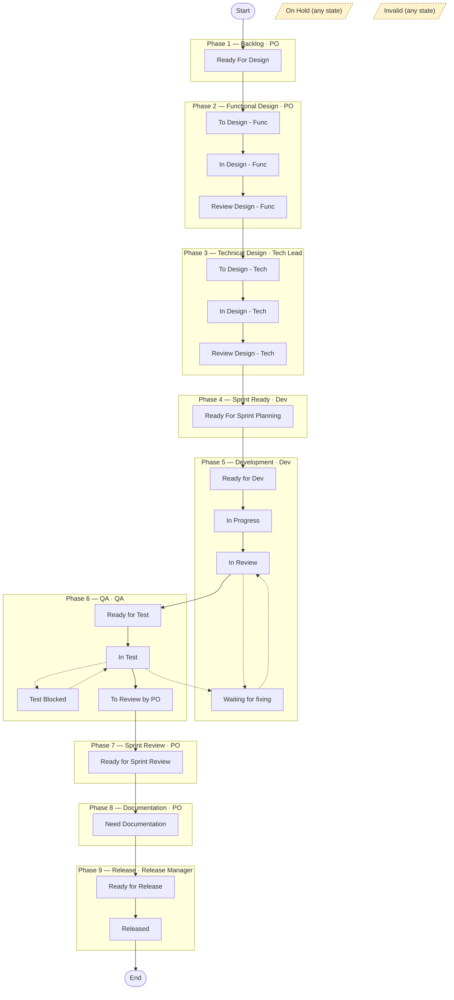

# Jira INTRD — User Stories

Reference rules for User Story issues on the INTRD project.
Read together with the main `SKILL.md`.

## Scope — functional only

Every User Story this lane authors is a **functional** story — it describes user-facing value a
PO can validate. Work whose only purpose is technical (refactor, migration, index, internal API,
infrastructure) is **not** a Story: it is an **Enabler**, which is architect-owned and split out
during Technical Design. The func/PO lane keeps Stories functional and flags technical needs;
it authors an Enabler only on explicit request. Full rule and litmus: `SKILL.md`
§ *Authoring boundary — User Stories are functional, never technical*.

## Story scope — demonstrable, not just functional

Functional (above) is necessary but **not sufficient**. Every User Story must be **both**:

- **Functional** — it expresses user or business value: the *what* and the observable
  behaviour, not a technical layer or implementation step.
- **Demonstrable** — its outcome can be shown to a stakeholder at a sprint review as an
  observable behaviour or artifact, **on its own** — independently of any other Story.

**The demonstrability test.** When authoring or reviewing a Story, apply one check: *could a PO
demo this Story's outcome on its own at a sprint review?* If the only way to show it is *through*
another Story, it is **not** an independent Story.

**Anti-pattern — horizontal (pipeline-stage) slicing.** Do not slice one capability into a Story
per technical pipeline stage. Each layer is invisible on its own and demoable only through the
Story that assembles them, so each fails the demonstrability test even when it carries no
implementation detail — it reads as "functional" but is not demonstrable.

- **Wrong** — slice by pipeline stage (select → compute → validate → write). Each layer is
  invisible alone.
- **Right** — slice **vertically**: each Story a thin end-to-end increment of observable value.

*Worked example (INTRD e-reporting / OER).* The "Generate an e-reporting file" capability was
first sliced by pipeline stage into separate Stories — *Aggregate transactions*, *Validate
against the XSD*, *Write the file to the output path*, *Determine the perimeter*, *Exclude
OSS/IOSS*. None had an observable outcome alone — you could only demo them through *Generate* —
so although they read as functional (no Java / implementation detail), they failed the
demonstrability test. Fix: re-slice vertically by folding the internal steps into the
demonstrable *Generate* Story (their rules became its acceptance) and letting the architects
create the aggregate / validate / write work as Enablers / sub-tasks underneath.

**Routing non-demonstrable work.** Technical sub-steps that are not independently demonstrable do
**not** become User Stories. They live **inside the demonstrable Story's acceptance**
(`customfield_10136`) and are realised as architect-created **Enablers / sub-tasks** during
Technical Design — see `enablers.md` § *Ownership — architect-initiated* and `SKILL.md`
§ *Authoring boundary — Technical design belongs to the architect lane*. This rule is the
**upstream complement** to those boundaries: the func/PO lane must not even *create*
technical-layer Stories in the first place.

**Reviewer expectation.** Reject a Story that is not independently demonstrable. Either **merge it
into the demonstrable Story it serves** — folding its rules into that Story's acceptance — or
**reclassify it as an Enabler**. Reclassification is never silent: Enablers are architect-owned
(`enablers.md` § *Ownership — architect-initiated*), so flag the technical need for the architect
lane rather than quietly converting it yourself.

## Naming

When a Story belongs to an Epic, its summary **must** follow the `[<epic-suffix>] (<n>) <story name>` pattern defined in [`epics.md` § Child Story naming](epics.md#child-story-naming). The suffix is chosen at Epic level and must be copied verbatim to every child Story — do not vary casing or spelling.

> **The `(<n>)` is not a stable identifier.** It is a **delivery-order label** — renumbered (sometimes **retroactively**) to match the actual development order (lower = further along), and a Story can move to another Epic and be renumbered under that Epic's scheme. **Always identify a Story by its Jira key (`INTRD-#####`)**, never by its `(<n>)`, in cross-references, docs, and links. See [`epics.md` § Child Story naming](epics.md#child-story-naming).

## Field mapping

User Stories use four custom fields **instead of** the standard `description` field:

| Field name        | Field ID            |
|-------------------|---------------------|
| Requirement       | `customfield_10134` |
| Functional design | `customfield_10135` |
| Acceptance        | `customfield_10136` |
| Technical design  | `customfield_10137` |

**The func/PO lane authors the first three fields only.** *Technical design* (`customfield_10137`) is architect-lane territory and is left as the empty template scaffold; authoring it is the architect lane's job (the `oc-ar-tech-design` skill, where available) — or, by explicit user request, here via the § *ADF recipe* below. See `SKILL.md` § *Authoring boundary — Technical design belongs to the architect lane*.

**Note on the standard `description` field.** A Story's standard `description` is normally unused in the PO field model (the four custom fields replace it). But the archi `oc-ar-ai-tech-design` skill may place an "AI-Friendly Technical Design" there. Before editing a Story, do **not** assume `description` is empty/disposable — if it holds tech-design content, treat it as architect-owned (read-only to the PO lane), the same boundary as `customfield_10137`.

In JQL, the User Story issue type is named **`Story`** (id `10001`) — not `"User Story"`.

## Field preset for full functional read

```
["summary", "status", "issuetype", "priority", "assignee", "parent", "labels", "components",
 "customfield_10134", "customfield_10135", "customfield_10136", "customfield_10137"]
```

## Template

User Stories have **one** template: **INTRD-1486**, in the light format since 2026-10-05 (§ *Story
structure — light format*). Fetch it with `responseContentFormat: "adf"` to preserve its formatting.
The `components` field (`Backend`, `Frontend`, both, or other) is set on every Story, independently
of the template.

The backend (INTRD-42531) and frontend (INTRD-42554) variants were **retired and deleted on
2026-10-05**: only one author had used them, and as hand-maintained copies they kept drifting
behind the generic template. Do not recreate them. A Story's discipline shows in its `components`
and its content, not in a separate template.

**This skill documents the template's structure, and the documented structure is canonical.** If
INTRD-1486 and this skill ever disagree, author to the skill and flag the gap to the user.

## Story structure — light format

Adopted **2026-10-05** by rewriting `INTRD-1486` in place, after POs and readers both reported the
previous template as too heavy. Measured on the 208 Stories created since 2026-04-01: most authors
skipped the template or left about 85% of its sections empty, and the fully filled form (median
~8,300 characters across the PO fields) restated each rule three or four times, once per section.
Rewriting `INTRD-44602` in this format kept every fact at half the size.

**Three rules apply to the three PO fields** (Technical design keeps its own scaffold):

- **Write each fact once, in the section that owns it.** A rule lives in *Business rules*. A
  message's wording lives in *Messages*, keyed to its rule. A test points to the rule it verifies.
  Never restate a rule as a journey step, a data note or a test expectation.
- **An optional section that does not apply is deleted, not left empty.** An empty heading is noise
  for every reader. A mandatory section that does not apply gets one line: `N/A — <reason>` for
  *GUI*, `None` for *Impact on existing data*.
- **Author hints are grey placeholder text, never panels.** The template carries its hints as grey
  italic text (`em` + `textColor` `#97a0af`) where the content goes, so writing over a hint removes
  it. Add no note or info panel to a Story field, and leave no hint text in a filled Story.

| Field | Section | Status | Content |
|---|---|---|---|
| *Requirement* (`10134`) | — | mandatory | *As a … I want … so that …*, then at most a few lines of context and what the Story traces to (Epic, ADR, spec, customer request). |
| *Functional design* (`10135`) | Business rules | mandatory | Table *#* / *When* / *Then*, one row per rule, numbered `BR-1`, `BR-2`… *When* holds the condition, including who may act; *Then* holds the observable outcome. |
| | Messages | optional | Table *Rule* / *Message (EN)* / *Message (FR)*. The trigger is the rule, never restated. |
| | Data | optional | One list item per piece of information — § *Data — naming decided model bindings*. |
| | GUI | mandatory | `N/A — <reason>`, or where it sits (Application › Menu › Page › Tab), the Figma link or screenshot, and the labels table — § *GUI labels — bilingual*. |
| | Impact on existing data | mandatory | One line; `None` is valid. |
| | User journey | optional | Only for a multi-step flow the rules do not already describe. |
| *Acceptance* (`10136`) | Dataset | optional | Table *ID* / *Object* / *Key attributes*, when tests share data. |
| | Test cases | mandatory | Table *Rule* / *Given* / *When* / *Then* — `stories-acceptance.md`. |
| *Technical design* (`10137`) | API, Error dictionary, Model, Services, Migration, GUI, Non regression checks, Limits & volumes | architect lane | Unchanged by the light format. Left as the empty scaffold at creation — `SKILL.md` § *Authoring boundary — Technical design belongs to the architect lane*. |

**Dropped on 2026-10-05 — do not reintroduce:**

- the *lead summary* blockquote at the top of *Functional design*: once the *Requirement* is short,
  it says the same thing twice;
- *User journey* as a mandatory section: it restated the rules;
- the *Information requirements* table (now the *Data* list) and the *Function transition* table
  (now the one-line *Impact on existing data*);
- the test-case `Type` column, replaced by `Rule`, which makes coverage visible;
- every hint panel in the three PO fields.

**Reviewer expectation.** Reject a Story with a missing or blank mandatory section, an optional
section left as an empty heading, a rule restated in another section, or template hint text left
in place.

## Template-seeding automation — set all four fields IN the create call

INTRD runs one automation rule, **"Issue created (one automation to rule them all)"**, that seeds
the issue template a few seconds after creation. It is guarded — for a Story the guard is
**`requirement is not empty`** (other types guard on `description is not empty`) — but **the guard
reads the issue as it stood at trigger time**, not as it stands when the override runs. Anything
written in a *follow-up* call is invisible to that guard and gets overwritten.

**So: create the Story with all four custom fields already populated, in the single
`createJiraIssue` / `POST /issue` call.** The content is then present in the trigger snapshot, the
guard fires, and the override is skipped.

- **All four fields only accept ADF.** Each value must be a full ADF document object reproducing the
  template's dark-red-heading + rule styling. Plain Markdown is rejected with
  `"Operation value must be an Atlassian Document"`.
- **Author content** for the three PO-owned fields: `customfield_10134` (Requirement),
  `customfield_10135` (Functional design), `customfield_10136` (Acceptance).
- **`customfield_10137` (Technical design)** — set it to the **empty template scaffold only** (the
  dark-red headings, author-hint panels, and the *Limits & volumes* placeholder, with no
  technical-solution content filled in). Authoring this field is the architect lane's job (the
  `oc-ar-tech-design` skill, where available) — see `SKILL.md` § *Authoring boundary — Technical
  design belongs to the architect lane*. Fill it here only when the user explicitly asked you to
  write the technical design; otherwise defer to `oc-ar-tech-design`.

> **Send all four, always — the guard is all-or-nothing.** Because the Story guard tests only
> `requirement`, a create that fills *Requirement* but leaves the other three empty still skips the
> whole override: the remaining fields stay **empty, with no scaffold**. Supplying `10137`'s empty
> scaffold at creation is therefore mandatory, not optional.

**The automation copies the template issue's four fields live.** An edit to `INTRD-1486` reaches
the next Story created, with no change to the rule. Verified 2026-10-05: a bare create (summary
only), made minutes after the light format was written to `INTRD-1486`, was seeded with it within
20 s. So **an edit to `INTRD-1486` is a change to every future Story**: back up its four fields
first, and verify with a bare create afterwards.

The fields do **not** appear in `createmeta` for a Story — they are not on its create screen — yet
`POST /issue` accepts them. Do not conclude from `createmeta` that they must be set in a second call
(same trap as `description` on a Bug; see `bugs.md`).

### Why the old two-step recipe lost content

Earlier versions of this skill mandated *create bare, then immediately `editJiraIssue`*. **That
instruction was the cause of the data loss it claimed to avoid** — it guarantees the write lands
inside the snapshot window. Measured on INTRD, 2026-08-03:

| Offset | Event |
|---|---|
| `+0.0 s` | `POST /issue` — Requirement empty. **Rule triggers and snapshots the issue here.** |
| `+1.1 s` | follow-up `PUT` writes the four fields |
| `+3.0 s` → `+3.3 s` | rule sets `Architect`, then `Account` |
| `+3.8–4.0 s` | rule re-evaluates its guard **against the `+0.0 s` snapshot**, sees Requirement empty, and overwrites all four fields with template boilerplate |

Both calls return success (`201`, then `204` with an empty body), so **status codes carry no
information** about whether the content survived. Five of six Stories written back-to-back in one
loop were silently replaced by boilerplate; the one survivor had simply been written ~11 s after
creation, past the window.

Verified by controlled test: an identical Story created with the four fields **inside** `POST /issue`
was left untouched (the rule wrote only `Account`), while the control — bare create, `PUT` at
`+1 s` — was clobbered.

### Verify after creating (cheap, and it catches the whole failure class)

The failure is silent and each damaged Story is *individually well-formed* — full of the template's
own headings and hint panels — so "is the field non-empty" passes. Two checks that do work:

1. **Marker check.** Re-read past the automation window (`> 10 s` after creation) and assert a
   story-specific string you authored is still present:
   ```sh
   jira raw GET "/issue/$K?fields=customfield_10134" | jq -e --arg m "<a phrase unique to this Story>" \
     '(.fields.customfield_10134|tostring)|contains($m)' >/dev/null || echo "CLOBBERED: $K"
   ```
2. **Cross-issue check, for batches.** Compare rendered field lengths *across* the created set —
   boilerplate makes them byte-identical, and genuinely different Stories cannot be:
   ```sh
   for K in "$@"; do jira raw GET "/issue/$K?fields=customfield_10134,customfield_10135,customfield_10136,customfield_10137" \
     | jq -r --arg k "$K" '[$k] + [.fields|to_entries[]|(.value|tostring|length)|tostring] | join(" ")'; done
   ```
   Identical rows mean identical content — i.e. the template, not your Stories.

If a Story was clobbered, a plain re-`PUT` of the same payload repairs it — nothing about the payload
is wrong, only its timing. Wait past the window first.

### ADF recipe — dark-red heading + rule (copy-pasteable)

This recipe supplies the shared ADF heading/rule/panel vocabulary and the EMPTY `customfield_10137` scaffold; the FILLED structure of `customfield_10137` is owned by the architects' `oc-ar-tech-design` (`references/adf-template.md`), where available.

Section headings are real ADF **`heading` nodes** (not styled `paragraph` nodes), with the heading text marked `strong` + `textColor` `#bf2600`, and a `rule` node immediately after each one. `#bf2600` is the func/brand heading colour; other Opencell skills (e.g. `oc-ar-ai-tech-design`) may emit `#FF0000` — keep func-authored content on `#bf2600` and do not silently normalise to another value. Use `attrs.level` to encode the hierarchy:

- **Level 1** — the field title, matching the field name verbatim: `Requirement`, `Functional design`, `Acceptance`, `Technical design`. One per field, at the top.
- **Level 2** — the main sections (`User journey & Process flow`, `GUI`, `Test cases`, `Component tree`, …).
- **Level 3 / 4** — subsections nested under a level-2 section.

Mirror the template's own structure (**INTRD-1486**) — every section in it is a `heading` node at the level above. Reference issue with the correct full shape: **INTRD-43398** (backend Story).

```json
{
  "type": "doc",
  "version": 1,
  "content": [
    {
      "type": "heading",
      "attrs": { "level": 1 },
      "content": [
        {
          "type": "text",
          "text": "Functional design",
          "marks": [
            { "type": "strong" },
            { "type": "textColor", "attrs": { "color": "#bf2600" } }
          ]
        }
      ]
    },
    { "type": "rule" },
    {
      "type": "heading",
      "attrs": { "level": 2 },
      "content": [
        {
          "type": "text",
          "text": "Section heading",
          "marks": [
            { "type": "strong" },
            { "type": "textColor", "attrs": { "color": "#bf2600" } }
          ]
        }
      ]
    },
    { "type": "rule" },
    {
      "type": "paragraph",
      "content": [{ "type": "text", "text": "Body content here." }]
    },
    {
      "type": "table",
      "attrs": { "isNumberColumnEnabled": false, "layout": "default" },
      "content": [
        {
          "type": "tableRow",
          "content": [
            { "type": "tableHeader", "attrs": {}, "content": [{ "type": "paragraph", "content": [{ "type": "text", "text": "Column A" }] }] },
            { "type": "tableHeader", "attrs": {}, "content": [{ "type": "paragraph", "content": [{ "type": "text", "text": "Column B" }] }] }
          ]
        },
        {
          "type": "tableRow",
          "content": [
            { "type": "tableCell", "attrs": {}, "content": [{ "type": "paragraph", "content": [{ "type": "text", "text": "Value 1" }] }] },
            { "type": "tableCell", "attrs": {}, "content": [{ "type": "paragraph", "content": [{ "type": "text", "text": "Value 2" }] }] }
          ]
        }
      ]
    }
  ]
}
```

### Clickable links (ADF `link` mark)

Jira ADF does **not** auto-linkify a raw URL in a text node — a pasted URL renders as **plain, unclickable text**. Make it clickable with a real `link` mark on the text:

```json
{ "type": "text", "text": "Open the mockup in Figma",
  "marks": [{ "type": "link", "attrs": { "href": "https://www.figma.com/design/…?node-id=7648-3" } }] }
```

Applies to every URL the lane writes into any field (a Figma link in *GUI*, a spec/reference URL in *Requirement*, etc.). Verify after the write: `GET …?expand=renderedFields` and check the field HTML for `<a href="…">`.

### Inline images (embed an attachment in the field body)

To show an image **in the field body** (not just in the Attachments panel — e.g. a GUI mockup snapshot):

1. **Upload it as a real attachment** — `POST …/issue/<key>/attachments` with header `X-Atlassian-Token: no-check`. The Rovo MCP has **no** attachment-upload tool, so use the `jira` helper / `curl`. Note the returned attachment `id`.
2. **Embed with a `mediaSingle` → `media` node of `type: "external"`** whose `url` is *that attachment's own content URL*:

```json
{ "type": "mediaSingle", "attrs": { "layout": "center" },
  "content": [{ "type": "media", "attrs": {
    "type": "external",
    "url": "https://<site>.atlassian.net/rest/api/3/attachment/content/<attachmentId>",
    "width": 1400, "height": 1210 } }] }
```

- **Do not** use `type: "file"` with the attachment id — Jira rejects it with **`ATTACHMENT_VALIDATION_ERROR`** (a `type:"file"` media node needs a Media Services **UUID + collection**, which the attachments REST API does not expose).
- The image **must remain a real attachment** — the external node only *renders* it; the attachment is the store. Keeping both means it survives export/mobile **and** satisfies `SKILL.md` § *Destructive edits on fields containing inline media* (nothing is orphaned). Renders inline for authenticated Jira users.
- Verify: `expand=renderedFields` → the field HTML contains `">`. That proves the node, not the file: also check the attachment id is still in `fields=attachment`.
- **Moving an existing image between fields** (e.g. out of a legacy `description`) goes through this recipe: re-upload, embed, then edit the source field. Removing a pasted image from its own field deletes its attachment — `SKILL.md` § *Removing an image from its field deletes the attachment*.

> The whole PO field set (`customfield_10134`–`10137`) is written as ADF, all four inside the create call (§ *Template-seeding automation*) — via the `jira` helper (`jira raw POST /issue @payload.json`) or `createJiraIssue`. Build the ADF (headings/rules/tables/links/media above) with a small script rather than by hand.

## Limits & volumes (story-level)

Cross-cutting rule and strict-answering policy: see `SKILL.md` § *Limits & volumes — mandatory reflection*. This section is the story-specific checklist.

**Authoring boundary.** This section lives inside *Technical design* (`customfield_10137`), which the func/PO lane does **not** author — see `SKILL.md` § *Authoring boundary — Technical design belongs to the architect lane*; authoring it is the architect lane's job (the `oc-ar-tech-design` skill, where available). So on a Story the checklist below is **not this lane's to fill**: leave it as the template placeholder for the architect lane / Tech Lead, and when reviewing a Story, verify it has been answered point by point. Author it yourself only when the user explicitly asks you to write the technical design (otherwise defer to `oc-ar-tech-design`). The checklist that follows is the reference the section must satisfy — both for whoever fills it and for Claude checking it during review.

**Placement.** The limits-and-volumes content lives inside *Technical design* (`customfield_10137`), as the final sub-section, under a heading `Limits & volumes`. It comes after the rest of the technical design so it reflects the chosen approach, not a vacuum.

**Inherit from the Epic.** Before filling this section, open the parent Epic and copy the relevant envelope figures verbatim into a short *Inherited envelope* paragraph. Then answer the checklist below in terms of this story's slice of that envelope.

**Checklist.** Answer each point, or write `N/A — <one-line reason>`:

1. **Per-request volume** — for each new or modified endpoint touched by this story: typical and worst-case input size (record count, payload bytes), and the response shape & size at the worst case.
2. **Result-set size & pagination** — for any list, search, or export added or modified: default page size, maximum page size, total result-set cap, and behaviour beyond the cap (truncate / paginate / error).
3. **Concurrent users on the affected flow** — expected concurrency on the user-facing flow this story delivers, drawn from the Epic envelope. Call out any flow where contention matters (locks, optimistic concurrency, queue ordering).
4. **Latency target** — p50 / p95 target for the new or modified user action, end-to-end. State the measurement point (browser, API gateway, service).
5. **Data-volume horizon at delivery** — expected row count / storage footprint of the new or modified entity at GA, and the growth rate assumption (per day / per tenant / per active user). Distinguish "right after release" from "12 months after release".
6. **Degradation behaviour** — what the user sees when a limit above is hit: clear error, soft truncation, graceful fallback, queueing. Silent failure is never acceptable.
7. **Telemetry hooks** — which metrics / logs / traces let us observe each of the above in production. If observability is deferred, link to the follow-up issue.

**Reviewer expectation.** A story whose technical design ends with seven `N/A — ...` lines is suspect: at minimum, latency target, data-volume horizon, and degradation behaviour are almost always applicable for any story that touches a backend flow or a non-trivial UI list.

## Data — naming decided model bindings

Cross-cutting principle and the bounded-exception framing: see `SKILL.md` § *Decided model bindings
— name the conceptual home in the functional design*. This section is the Story-level mechanics.

The *Data* section of *Functional design* (`customfield_10135`) lists the information a Story needs
**in business terms**, one list item each. **Default:** we don't directly name database/model
properties — we list the information (e.g. "the customer's VAT regime"), and the architect decides
where it lives. Most Stories stay here. The section is optional: a Story whose rules already name all
the information it touches needs no *Data* section.

**Item shape:** `**<Information>** — held on <Entity.attribute> — <constraints>`. The *held on* part
is present only when the model home is decided; otherwise the item is `**<Information>** —
<constraints>`.

**Bounded exception — already-decided model element.** When a model decision is **already fixed**
(e.g. settled in design) and the architect must respect it, name the conceptual entity/attribute in
the item's *held on* part (e.g. `EreportingSetting.vatRegime`), with the decided input and its
source (ADR / spec) in the constraints. Stay conceptual — the physical design (tables, JPA mappings,
indexes) belongs in Technical design. The template's hint says the same: *"Name its conceptual home
only when the model decision is already made."*

This is the exception for ALREADY-DECIDED elements, **not** a reversal of the default — a Story with
no settled model decision still just lists information.

**Reference the Epic, don't duplicate it.** When the parent Epic carries a *Domain model & decided
design inputs* section (`epics.md` § *Domain model & decided design inputs*), the Story names only
**its slice** and references the Epic — the shared model is defined once on the Epic, not copied into
every Story.

**Template coverage.** The template (INTRD-1486) carries the *Data* section and its hint. Stories
written before 2026-10-05 may carry the older *Information requirements* table, some with a *Held on
(conceptual model)* column; when editing one that has not been converted, keep its shape unless the
user asks for a conversion.

**Reviewer expectation.** When a decided model element exists for a Story's data, reject a *Data*
section that names the information but omits its conceptual home.

## GUI labels — bilingual (EN + FR)

> **Designing the screen (not just describing it).** When a Story has GUI impact, the *GUI* section
> should carry an **actual design** — real Design-System components, tokens, a screenshot, and a
> Figma link — not prose that leaves the screen for a developer to invent. Producing that design is
> the **`oc-fn-gui-design`** skill's job (it reads the Opencell Figma design system — MUI v6 — in the
> same Phase-2 lane). This lane still owns **writing** the design into the Story: the ADF, the
> bilingual labels below, and the inline-media safety rule for the screenshot (see `SKILL.md`
> § *Destructive edits on fields containing inline media*). `oc-fn-gui-design` produces the artifacts
> (link + dated screenshot + grounded spec) and hands them here.

When a Story has a real GUI (the *GUI* section is **not** `N/A`), every user-facing label must be given in **both English and French** — field labels, **enum / selector values**, buttons, tab and section titles, and actions. The form is the *GUI* section's labels table:

| Element | Label (EN) | Label (FR) |
|---|---|---|

The generic Story template (INTRD-1486) carries the table and asks for *"every label in EN and FR"*, but this is easy to miss at authoring time, so it is an explicit rule here. It complements the *Messages* table, which also requires EN + FR.

- **Enums** — the **code stays English** (e.g. `NON_TAXABLE_PERSON`); give **both** display labels — EN "Non-taxable person" / FR "Non-assujetti". The French regulatory term belongs in the FR label, never in English prose.
- **Proper French regulatory names** (VAT-regime names: *réel normal mensuel*, *franchise en base*, …) are identical in both columns — note that rather than inventing a translation.
- **Identical FR — mark it, don't duplicate the string.** The **EN + FR structure stays mandatory**,
  but where the FR value is genuinely identical to the EN (proper regulatory names, product names,
  enum codes shown verbatim, non-translatable tokens) you may enter it **once** and mark the pair
  identical — an FR cell of `= EN` (or a single merged note) — rather than copying the string into
  both columns. Write an **explicit, distinct FR value whenever it differs from EN**, which is the
  common case for user-facing prose and messages. The point is to cut duplicate noise, **never** to
  drop a genuine translation. A *blank* FR cell is a hole, not an "identical" shorthand — identity
  must be **marked**, not implied.
- **Backend-only Stories** with no Portal surface keep `GUI = N/A — <reason>` and are exempt.

**Reviewer expectation.** Reject a Story whose GUI section leaves any user-facing label's FR value
unaddressed — it must carry either a distinct FR translation or an explicit identical-to-EN marker
(`= EN`). A blank FR cell is a defect; a single-language label is a defect.

## Acceptance tests

Detailed rules for filling `customfield_10136` (*Acceptance*) live in
`stories-acceptance.md`. Read that file whenever the user asks Claude to
write, refine, or review acceptance tests.

It carries, among other things, the **hard precondition that the Functional
design must be solid before any test is written** — when the FD has gross
holes (a missing mandatory section, an empty *Business rules* table, rules
without a condition or an outcome, a message without both EN and FR),
Claude must refuse to generate tests and list the holes back to the PO
instead of papering over them.

## Workflow

User Stories on INTRD follow a 9-phase workflow. Each phase groups one or several
Jira statuses and has a single accountable role. Roles in use: **PO**, **Tech Lead**,
**Dev**, **QA**, **Release Manager**.

### Phases

| # | Phase                | Statuses                                                                                                      | Responsible                          |
|---|----------------------|---------------------------------------------------------------------------------------------------------------|--------------------------------------|
| 1 | Backlog / Created    | Ready For Design                                                                                              | PO                                   |
| 2 | Functional Design    | To Design - Func → In Design - Func → Review Design - Func                                                    | PO                                   |
| 3 | Technical Design     | To Design - Tech → In Design - Tech → Review Design - Tech                                                    | Tech Lead                            |
| 4 | Sprint Ready         | Ready For Sprint Planning                                                                                     | Dev *(Dev Leads evaluate the load)*  |
| 5 | Development          | Ready for Dev → Need Sync (Before Dev) → In Progress → In Review → Need Sync (After Dev) → Waiting for fixing | Dev                                  |
| 6 | QA                   | Ready for Test → In Test → Test Blocked → To Review by PO *(pre-validation before sprint review)*             | QA                                   |
| 7 | Sprint Review        | Ready for Sprint Review                                                                                       | PO                                   |
| 8 | Documentation        | Need Documentation *(written after US validation)*                                                            | PO                                   |
| 9 | Release              | Ready for Release → Released                                                                                  | Release Manager                      |

### Side states

| Status   | Meaning                                                                                              |
|----------|------------------------------------------------------------------------------------------------------|
| On Hold  | Story paused, not to be processed until further notice. The reason **must** be written in a comment. |
| Invalid  | Story closed without delivery (cannot be reproduced, unclear, abandoned).                            |

### Notes on the workflow

- **Phase 2 (Functional Design)** does *not* include `To Review by PO`. That status lives at the end of QA, as a pre-validation before the sprint review.
- **Phase 4 (Sprint Ready)** is owned by Dev — concretely, Dev Leads evaluate the load on each US before sprint planning.
- **Phase 6 (QA)** ends with `To Review by PO`, a pre-validation of the delivered work before the sprint review.
- **The PO verdict on a Story in `To Review by PO`** — the available transitions and when each applies — is covered by `po-review.md`.
- **Phase 8 (Documentation)** runs *after* the PO sprint-review validation, not before.
- The full Jira workflow diagram (with all valid transitions) is the source of truth — refer to it in Jira when in doubt about a specific transition.

### Workflow diagram (happy path)

Solid arrows = nominal flow. Dashed arrows = return loops (fix or unblock).


